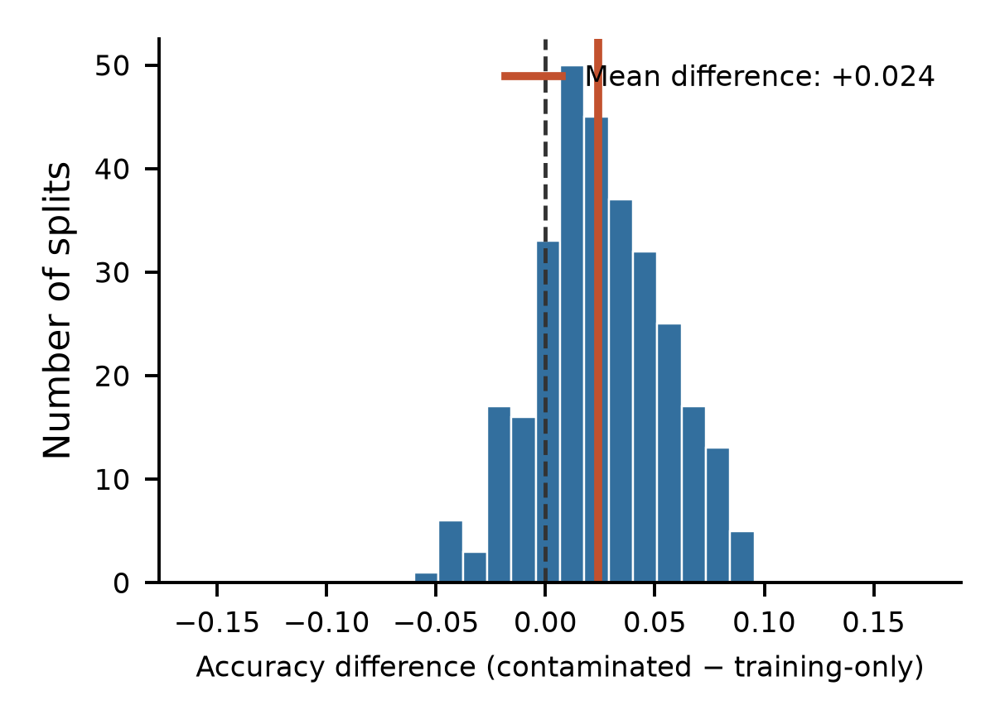
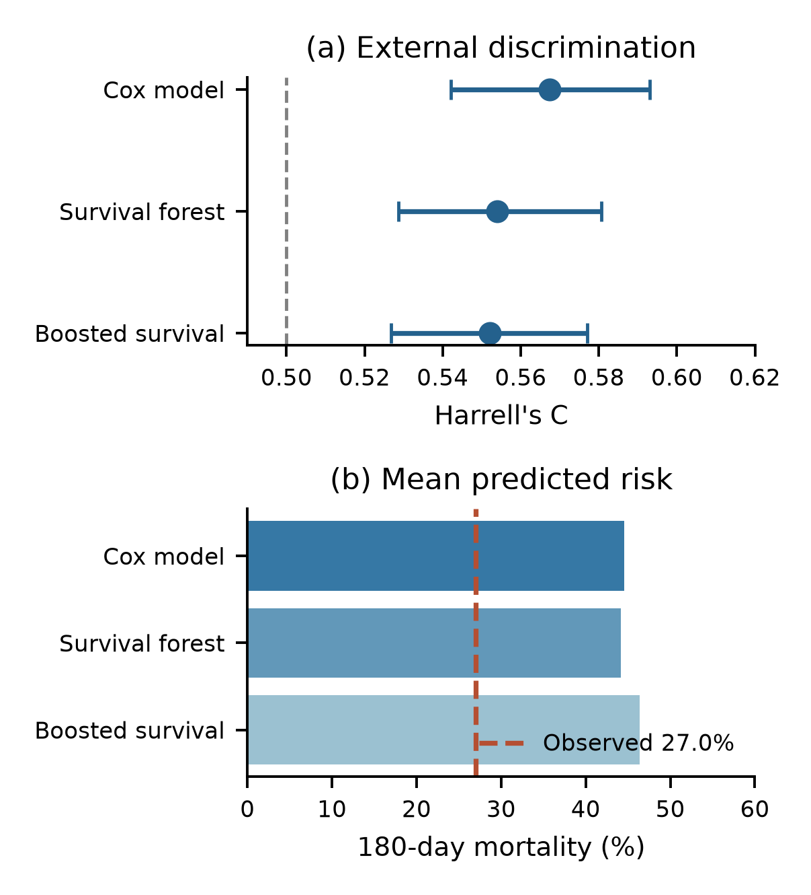
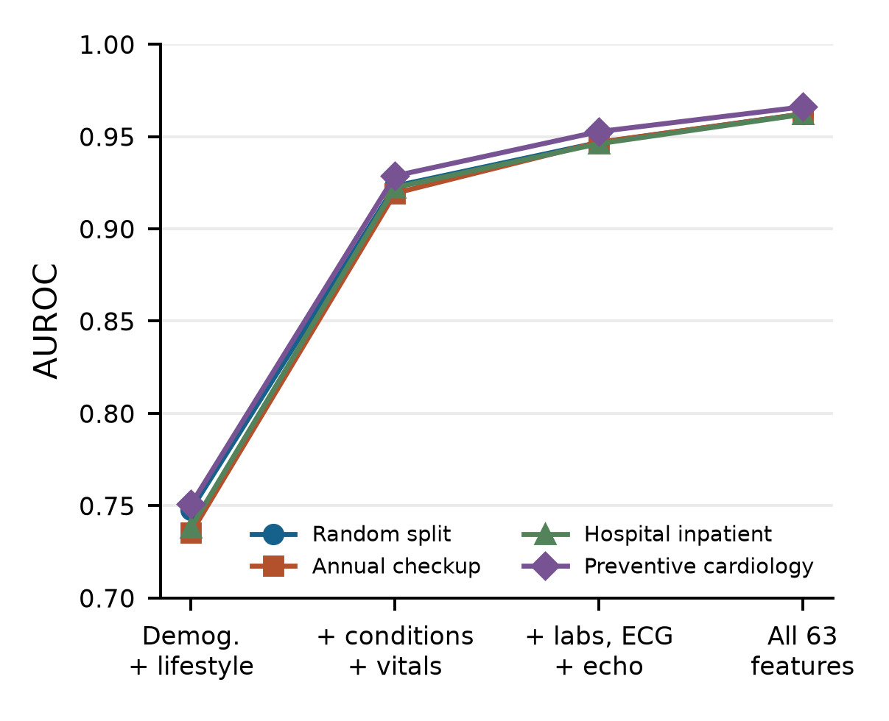

# A Multi-Cohort Evaluation of Heart Failure Prediction: Paired Resampling, Model Transport and Feature-Group Analysis

Vivek Patel, Umang Patel, Jeetu Mehra, Priyansh T
Department of Artificial Intelligence, SVNIT, Surat, India | u24ai040@aid.svnit.ac.in

**Abstract—** High benchmark scores do not by themselves establish that a heart failure model can be used in clinical practice. We examine three related threats to interpretation: information leakage, cross-cohort transport and uncertain dataset provenance. We evaluate paired resampling and censoring-aware survival models on the 299-patient UCI Heart Failure Clinical Records dataset, and assess fixed-model transport to 1,384 SUPPORT patients with congestive heart failure. We then audit a separate 50,000-row cardiovascular file and evaluate four nested predictor groups with a histogram gradient-boosting model using a random split and three leave-one-source-label-out tests. With follow-up time excluded, the UCI random forest had mean accuracy 0.726 with training-only SMOTE and 0.750 in a deliberately contaminated simulation evaluated on the same 90 original test patients. A UCI-trained five-predictor Cox model yielded SUPPORT Harrell's C of 0.567 (fixed-model bootstrap interval 0.542–0.593) and overpredicted mean 180-day mortality by 0.175 (0.150–0.199). In the separate 50,000-row file, random-split AUROC increased from 0.748 for demographics and lifestyle to 0.923 with comorbidities and vital signs, 0.947 with laboratory and cardiac tests, and 0.962 with all candidates; held-out source-label AUROCs for the full set were 0.962–0.966. These source labels have not been verified as independent institutions, the outcome construction is unclear, and the local file's provenance is unconfirmed. High internal discrimination therefore does not validate a clinical prediction model. The study contributes a reproducible, integrated audit rather than a claim of a novel algorithm or a universal accuracy ceiling.

**Index Terms—** Heart failure, data leakage, SMOTE, external validation, dataset provenance, model evaluation.

## I. INTRODUCTION

Heart failure prediction is a frequently studied clinical machine-learning task, but a model's apparent accuracy depends on how patients, outcomes and predictors are defined. The UCI Heart Failure Clinical Records dataset contains 299 patients and 96 deaths [1], [2]. Its modest size and variable follow-up make it useful for illustrating how model evaluation can go wrong. Ali et al. reported 97.78% random-forest accuracy in a study using this dataset [3]. That figure describes their reported experiment; it is not evidence that all implementations have the same design, and our simulations cannot establish why any individual published result was obtained.

Leakage can occur when information unavailable at the intended prediction time, or information from evaluation patients, influences model development [4]. Follow-up duration is known only after observation and cannot be a baseline predictor. SMOTE creates synthetic minority-class samples by interpolation [5]; fitting it before partitioning may expose training to information from held-out observations. Prior work has already analysed follow-up-time leakage in this cohort [6], [7] and considered censoring-aware models [8]. Naeem et al. [7] compared nine classifiers with and without follow-up time using repeated nested cross-validation; their study also cautioned about small-sample and split dependence. Consequently, neither leakage nor survival modelling is presented here as a new discovery.

Our contribution is the combination of (1) a same-patient SMOTE contamination experiment and interpolation-endpoint tracing, (2) a fixed-model UCI-to-SUPPORT external assessment of discrimination and absolute risk, and (3) a new four-level nested feature-group experiment with paired AUROC differences and source-label holdouts for a separate 50,000-row file. The latter tests sensitivity to recorded groups, while distinguishing group-wise splits from independent clinical validation. This is an incremental methodological case study; priority for the combination has not been established by a systematic review.

## II. DATA AND STUDY DESIGN

### A. UCI and SUPPORT datasets

The UCI cohort includes 11 baseline predictors, follow-up time and a death indicator [1], [2]. For the primary UCI classification stress test, the follow-up-time feature is excluded. The external cohort is the congestive heart failure subgroup of SUPPORT [9], with 1,384 eligible patients after excluding three of 1,387 patients with missing creatinine. A UCI-trained model uses five shared baseline predictors: age, sex, log-transformed serum creatinine, serum sodium and diabetes. UCI and SUPPORT differ in era, setting, case mix and measurement context; differences in performance cannot be assigned to one cause. Data were obtained from Vanderbilt University Department of Biostatistics [10].

The two clinical datasets play different roles. UCI is the model-development sample; the same UCI observations recur in its repeated internal evaluations. The five predictors were selected for availability in both cohorts; the UCI-fitted models were evaluated on SUPPORT without retraining. The 50,000-row file does not contribute to fitting or evaluating the SUPPORT models. This separation matters because the binary label in the larger file has not been shown to represent the same outcome as observed mortality in UCI or SUPPORT. The roles of the three data sources are summarised in Table I.

### B. Separate 50,000-row file

The local file has 50,000 rows and 68 columns, including 13,047 positive HF_Risk_Binary labels (26.09%). The labels Annual_Checkup, Hospital_Inpatient and Preventive_Cardiology contain 14,854, 15,052 and 20,094 rows, respectively. A public dataset card names a file with matching dimensions and group counts but describes its origin as “synthetic or de-identified” [11]. The gated file was not downloaded for a byte-level comparison. Neither patient provenance nor the method, timing and clinical reference standard for the risk label are verified. These groups must therefore be interpreted as file labels, not independently confirmed hospitals or populations.

*TABLE I. Data and evaluation roles. The 50,000-row file is separate from UCI and SUPPORT.*

| Data / N | Outcome or label | Role |
| UCI / 299 | Death and follow-up | Paired SMOTE; survival development and CV |
| SUPPORT-CHF / 1,384 | Death and follow-up | Frozen-model external evaluation |
| 50k file / 50,000 | Binary risk label | Feature-group and source-label tests |

### C. Paired SMOTE stress test

For each of 300 stratified 70/30 splits of the UCI cohort, two 65-tree random forests with maximum depth 8 were evaluated on the same 90 original test patients. Training-only SMOTE was compared with a deliberately contaminated simulation in which SMOTE used all 299 original records before synthetic observations were assigned to training. The same original training patients and training class counts were retained in both arms. The contaminated arm is a stress test, not an exact reconstruction of a particular published pipeline. Synthetic neighbours were traced to identify held-out patients used as interpolation endpoints. Unscaled predictors, including binary fields, were used in standard SMOTE.

For K splits, the paired accuracy contrast is ΔA = (1/K) Σₖ [Aₖ,contaminated − Aₖ,training-only]. Percentiles across splits describe sensitivity to resampling, not a population confidence interval, because the same 299 patients recur. The stress test isolates a controlled contrast; it does not prove that SMOTE always increases accuracy.

### C.1. Factorial sensitivity experiments

The saved factorial experiment crossed full-data outlier removal, full-data versus training-only SMOTE, and inclusion versus exclusion of follow-up time. Three classifiers were evaluated over 1,000 stratified 70/30 splits per setting (24,000 model evaluations). A separate 4,800-evaluation random-forest grid examined time, pre-split SMOTE, full-data feature selection and test-set hyperparameter choice. In the first grid, test sets in some SMOTE arms also contain synthetic records; consequently, marginal accuracy contrasts reflect both pipeline and test-population changes. The paired stress test supplies a complementary comparison using the same original test patients.

### D. Censoring-aware internal survival benchmark

We additionally report the earlier saved comparison of a penalised Cox model, random survival forest, gradient-boosted survival and a binary random forest. Eleven UCI baseline predictors excluded follow-up time as an input; log transformations and standardisation were fitted on training folds. Repeated stratified five-fold cross-validation was run ten times. We report mean Harrell concordance, Uno concordance at 240 days, 180-day time-dependent AUC and integrated Brier score over 30–180 days. Fold-level standard deviations describe variation across dependent resamples and are not independent-sample confidence intervals. The binary model does not model censoring and has no estimated survival curve for integrated Brier score.

### E. External transport and uncertainty

A Cox proportional hazards model with L2 penalty 0.1 was fitted to all UCI patients using the five shared predictors and applied without refitting to SUPPORT-CHF. Follow-up was administratively truncated at 280 days; no selected SUPPORT patient was censored before day 180. Harrell's C and mean predicted minus observed 180-day mortality were calculated. We drew 1,000 patient bootstrap samples from SUPPORT while holding the fitted model fixed; percentile intervals describe external-patient sampling variation conditional on that model. They omit UCI training-sample and between-site uncertainty. The SUPPORT external validation is separate from the 50,000-row source-label experiments.

### F. New source-label and predictor-subset tests

Using the 50,000-row file, we compared one stratified random 80/20 split (seed 42) with three tests that held out each Source label in turn and trained on the other two. A histogram gradient-boosting classifier used 150 iterations, learning rate 0.08, 31 maximum leaves and L2 regularization 1. Median imputation with missingness indicators for numeric variables, most-frequent categorical imputation and one-hot encoding were fitted only on each training partition. The identifier, source label, target, future-hospitalization risk and 12-month survival probability were excluded from predictors.

We assessed four nested groups: 13 demographics and lifestyle variables; the same variables plus 12 comorbidity and vital-sign variables (25 total); those 25 plus 21 laboratory, ECG and echocardiography variables (46 total); and all 63 candidate predictors. The final 17 additional variables include symptoms, treatments, utilization and longitudinal trends. The groups were defined for this exploratory study; the record does not verify that any variable is available at a particular clinical decision time. Thus these are candidate-feature comparisons, not validated screening protocols.

Metrics were AUROC, average precision and Brier score. For each split, 500 test-row bootstrap resamples with fitted models held fixed provided percentile intervals for differences in AUROC between selected nested feature groups. Resampling the same test rows for each model preserves the pairing. Intervals omit model-training, model-selection and source-selection uncertainty. Group comparisons were exploratory and were not pre-registered.

For a test set of size n with binary labels yᵢ and estimated scores pᵢ, the Brier score is n⁻¹ Σᵢ (pᵢ − yᵢ)². The AUROC compares the rank of a randomly selected positive observation against a randomly selected negative observation; average precision summarizes precision over recall levels. Each metric addresses a different property: a high AUROC can coexist with poorly calibrated probabilities. Here the Brier score measures agreement with the file's recorded label and has no established clinical interpretation without an independently validated target.

## III. RESULTS

### A. Paired and factorial sensitivity

With time excluded, mean accuracy across 300 paired splits was 0.726 for training-only SMOTE and 0.750 for the contaminated arm (mean ΔA = 0.024); mean AUROC was 0.767 and 0.809, respectively. The 2.5th–97.5th percentiles of the paired accuracy differences were −0.033 to 0.078. On average, 51.5% of synthetic training rows in the contaminated arm had at least one test patient as an interpolation endpoint; 95.9% had at least one fractional binary predictor. These are properties of this simulation and its unscaled feature space.

*Fig. 1. Distribution of paired UCI accuracy differences across 300 repeated splits with follow-up time excluded. The red line marks the mean. Splits reuse patients and are not independent clinical samples.*

In the earlier three-factor grid, the saved random-forest marginal accuracy contrasts were +0.093 for inclusion of time and +0.065 for full-data SMOTE, averaging over the tested settings; outlier removal changed mean accuracy by +0.004. These contrasts are descriptive, with different test populations in the oversampling arms. None of the 24,000 recorded evaluations reached 97.78% under the tested configurations. This does not establish a general performance ceiling or determine how the published result was produced.

### B. Censoring-aware internal benchmark

Across ten repetitions of five-fold UCI cross-validation, mean Harrell's C was 0.731 for gradient-boosted survival, 0.729 for the survival forest and 0.700 for Cox regression (Table II). The survival forest's mean integrated Brier score was 0.158 over days 30–180. These internally validated scores use all 11 baseline variables and answer a different question from the five-variable transport experiment. Differences between models are descriptive and should not be interpreted as a demonstrated clinical advantage.

*TABLE II. UCI survival benchmark: means across 10 × 5-fold cross-validation. IBS is integrated Brier score over 30–180 days; the binary classifier has no survival-curve IBS.*

| Model | Harrell C | Uno C | AUC180 | IBS |
| Boosted survival | 0.731 | 0.745 | 0.755 | 0.163 |
| Survival forest | 0.729 | 0.749 | 0.764 | 0.158 |
| Binary random forest | 0.722 | 0.745 | 0.756 | — |
| Cox model | 0.700 | 0.712 | 0.717 | 0.163 |

### C. Transport to SUPPORT-CHF

In SUPPORT-CHF, the UCI-trained Cox model achieved Harrell's C = 0.567 (95% fixed-model bootstrap interval 0.542–0.593). Predicted 180-day mortality averaged 44.5%, compared with 27.0% observed; the mean difference was 17.5 percentage points (15.0–19.9). A random survival forest and gradient-boosted survival model produced external C values of 0.554 and 0.552. All comparisons reflect this particular population, five-predictor mapping and evaluation protocol.

*Fig. 2. Five-predictor UCI models applied without refitting to SUPPORT-CHF. Top-panel error bars are 95% patient-bootstrap intervals conditional on each fitted model; bottom panel compares average predicted 180-day mortality with observed mortality.*

### D. Random and source-label holdout

On the 10,000-row random test split, AUROC rose from 0.748 for demographics and lifestyle to 0.923 with comorbidities and vitals, 0.947 after adding laboratory and cardiac-test variables, and 0.962 with all candidates (Table III and Fig. 3). Average precision increased from 0.514 to 0.900 across the first and final groups, while Brier score decreased from 0.157 to 0.070. Adding laboratory and cardiac-test variables to the 25-variable group increased AUROC by 0.0236 (paired fixed-model test-bootstrap interval 0.0204–0.0268). The full set exceeded the same reference by 0.0390 (0.0351–0.0428). These contrasts describe performance on the recorded label and are not causal estimates or clinical effect sizes.

The all-candidate model achieved AUROCs of 0.962, 0.962 and 0.966 on the annual-checkup, inpatient and preventive-cardiology label holdouts. The ranking of the four nested groups was consistent across these tests. Similar scores across recorded labels do not establish independence or rule out common dataset-generation processes.

*TABLE III. AUROC for nested predictor sets across random and source-label holdouts. Source labels are not verified external sites. Values are rounded to three decimals.*

| Test split | 13 features | 25 features | 46 features | 63 features |
| Random (n=10,000) | 0.748 | 0.923 | 0.947 | 0.962 |
| Annual (n=14,854) | 0.735 | 0.919 | 0.947 | 0.962 |
| Inpatient (n=15,052) | 0.738 | 0.922 | 0.946 | 0.962 |
| Preventive (n=20,094) | 0.751 | 0.929 | 0.953 | 0.966 |

*Fig. 3. AUROC for four nested candidate-feature groups across the random test split and each held-out source label. Each point represents a separately trained model; the groups do not establish predictor availability at a clinical decision time.*

### E. Dataset fidelity and earlier benchmark review

In 40,604 complete records labelled female or male, the Pearson correlation between recorded eGFR and an estimate from the 2021 creatinine-based CKD-EPI equation was 0.467, with a median absolute difference of 23.82 mL/min/1.73 m². This comparison assumes compatible units, measurement times and equation conventions; it cannot determine whether the data are synthetic or identify their origin. Kidney-function equations are approximations and are not themselves a definitive reference standard [12].

The earlier 50,000-row notebook reported CatBoost AUROC 0.9639 on the same random-split design. Its so-called stacking ensemble is a fixed weighted blend, not a learned stacking model; the notebook fits preprocessing on the full training set, but does not implement the nested cross-validation described in its README. It also simulates events from Survival_Probability_12mo and generates follow-up times. The resulting Kaplan–Meier curves and Cox coefficients characterize that simulation and cannot be used as observed mortality evidence. Decision-curve plots are descriptive model calculations and do not demonstrate clinical utility without a validated endpoint, appropriate clinical setting and decision thresholds.

## IV. DISCUSSION

The paired experiment illustrates a concrete route by which a test observation can affect synthetic training data. Its positive mean difference is conditional on the model, features, oversampling and fixed UCI sample. The broad distribution of paired differences, including negative values, cautions against treating the mean effect as a universal correction factor. Previously reported factorial comparisons also change test-population composition when synthetic observations enter the test split; their marginal contrasts should not be interpreted as clean causal effects on a common patient set.

The external SUPPORT results address a different question: whether a frozen five-predictor UCI model transports to one distinct cohort. Its low concordance and overprediction indicate limited performance in this particular transfer, not proof that all heart-failure models fail to generalize. Different clinical eras, ascertainment, predictors and baseline risk are plausible explanations but were not isolated experimentally. The observed 180-day proportion is available for all selected SUPPORT patients under the stated censoring rule; the mean risk difference does not replace a full calibration assessment.

The 50,000-row random and group-wise tests suggest that this model learns stable relationships across the recorded source labels. They do not show external validation because the groups may share generation mechanisms or unobserved dependencies, and data collection provenance is unclear. The target may represent a constructed risk category rather than a verified incident outcome. Even when preprocessing is fit solely on training data, symptoms, medications and trends may encode information from after the intended decision point or from the process creating the label. The demographics-only analysis reduces the breadth of candidate predictors but does not establish that its variables precede the label. These uncertainties limit the interpretation of AUROC and decision curves.

The nested feature comparison gives a practical way to inspect where predictive information enters the model. The largest observed random-split change occurred between the demographics-only and comorbidity-plus-vitals sets; a smaller improvement followed the addition of laboratory and cardiac tests. These groups contain several variables each, and the same fixed model family was refitted for every set. Their aggregate contributions can reflect overlapping predictors, measurement patterns and the unknown procedure that produced the label. They cannot isolate the importance of a particular biomarker, quantify the benefit of ordering a clinical test, or demonstrate that the additional inputs improve outcomes in practice.

The stability across three source-label holdouts is also narrower than a multisite validation. Each model was developed within the same file, the group definitions and assignment process are not verified, and no independent future collection period is available. A stronger next study would register an index time, define whether the task is diagnosis or prediction, specify the outcome horizon and ascertainment procedure, and evaluate a locked model on records collected independently in a clinically relevant setting. It should report calibration and subgroup performance as well as discrimination, with uncertainty that includes model development where feasible.

### Limitations and reporting

Sample sizes were set by available records; no prospective precision calculation was documented. The UCI cohort is small, repeated splits are dependent, and the paired contaminated arm is intentionally artificial. External intervals condition on the trained UCI model. The 50,000-row experiments reuse one file and include exploratory feature sets and model choices; test-row bootstrap intervals do not account for adaptive model selection. A targeted literature search establishes relevant prior work but cannot establish exhaustive novelty. The unverified abstract-level literature coding in the earlier work is not used for quantitative claims here. Source code, saved results and dataset access conditions must be reviewed before release. Reporting should follow TRIPOD+AI where applicable [13]; completion of that checklist has not been asserted.

## V. CONCLUSION

A controlled SMOTE stress test, censoring-aware UCI benchmarking, a cross-cohort transport evaluation and a nested feature-group study expose different properties that a single high score can conceal. In these data, test-patient contamination altered average UCI accuracy, the fixed UCI model performed poorly in SUPPORT, and source-label holdouts retained high discrimination in a file with uncertain origin and label construction. Prospective use would require a defined prediction time and outcome, verified provenance, an independent clinically representative cohort and assessment of discrimination, calibration and utility.

## DATA AND REPRODUCIBILITY

UCI Heart Failure Clinical Records is available from the UCI repository [2]. SUPPORT data were obtained from http://hbiostat.org/data courtesy of the Vanderbilt University Department of Biostatistics [10]. The local 50,000-row file's redistribution rights and byte identity with the gated card [11] have not been established. The new feature-group and source-group scripts and numerical results accompany this draft; prior paired and SUPPORT scripts are in the earlier research repository. AI-assisted coding and drafting were used; authors must check all analyses and comply with venue disclosure policies.

## REFERENCES

[1] T. Ahmad et al., “Survival analysis of heart failure patients: A case study,” PLoS ONE, vol. 12, no. 7, e0181001, 2017, doi: 10.1371/journal.pone.0181001.

[2] D. Chicco and G. Jurman, “Machine learning can predict survival of patients with heart failure from serum creatinine and ejection fraction alone,” BMC Med. Inform. Decis. Mak., vol. 20, art. 16, 2020, doi: 10.1186/s12911-020-1023-5. Dataset: doi: 10.24432/C5Z89R.

[3] M. M. Ali et al., “A machine learning approach for risk factors analysis and survival prediction of heart failure patients,” Healthcare Analytics, vol. 3, 100182, 2023, doi: 10.1016/j.health.2023.100182.

[4] S. Kapoor and A. Narayanan, “Leakage and the reproducibility crisis in machine-learning-based science,” Patterns, vol. 4, no. 9, 100804, 2023, doi: 10.1016/j.patter.2023.100804.

[5] N. V. Chawla et al., “SMOTE: Synthetic minority over-sampling technique,” J. Artif. Intell. Res., vol. 16, pp. 321–357, 2002, doi: 10.1613/jair.953.

[6] A. Rane et al., “Discrete-time survival analysis for heart failure mortality prediction,” arXiv:2608.04140, 2026, doi: 10.48550/arXiv.2608.04140.

[7] A. Naeem, A. Ahmad, and K. Khan, “Leakage-controlled evaluation of machine learning for heart disease diagnosis and heart failure mortality prediction,” Spectrum of Engineering Sciences, vol. 4, no. 3, pp. 7526–7546, 2026, https://thesesjournal.com/index.php/1/article/view/3986.

[8] B. Srujana, D. Verma, and S. Naqvi, “Machine learning vs. survival analysis models: A study on right censored heart failure data,” Commun. Stat. Simul. Comput., 2022, doi: 10.1080/03610918.2022.2060510.

[9] W. A. Knaus et al., “The SUPPORT prognostic model: Objective estimates of survival for seriously ill hospitalized adults,” Ann. Intern. Med., vol. 122, no. 3, pp. 191–203, 1995, doi: 10.7326/0003-4819-122-3-199502010-00007.

[10] Vanderbilt Department of Biostatistics, “Datasets: SUPPORT2,” https://hbiostat.org/data/, accessed Nov. 1, 2026.

[11] Auric Grid Laboratory, “Cardiovascular Heart Failure Dataset,” dataset card, doi: 10.57967/hf/9314, accessed Nov. 1, 2026.

[12] L. A. Inker et al., “New creatinine- and cystatin C-based equations to estimate GFR without race,” N. Engl. J. Med., vol. 385, pp. 1737–1749, 2021, doi: 10.1056/NEJMoa2102953.

[13] G. S. Collins et al., “TRIPOD+AI statement: Updated guidance for reporting clinical prediction models that use regression or machine learning methods,” BMJ, vol. 385, e078378, 2024, doi: 10.1136/bmj-2023-078378.
